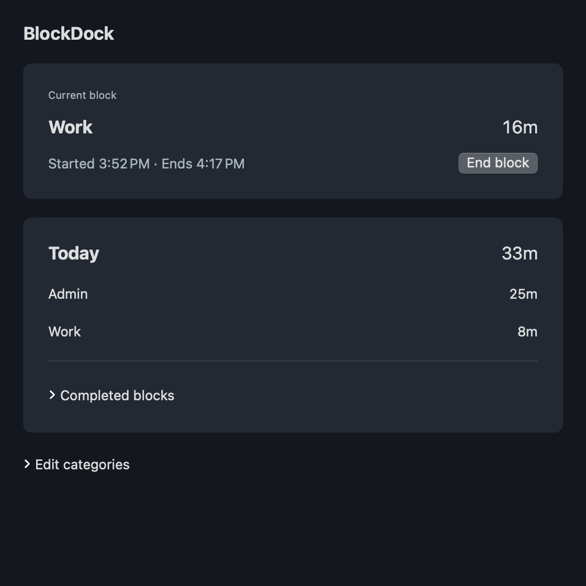

# BlockDock

BlockDock is a macOS time-block timer with a floating countdown and local history. I built it to help not just track, but also be more aware in the moment of how I spend my time, especially since much of my work is digital on the computer. You can pick and customize blocks of time, and choose which block you are currently on, simple local tracking is built in. A floating countdown will be present so you can be reminded of the current intended block or change it easily.

## Install

Download [BlockDock-macOS.zip](https://github.com/zackaryxu/blockdock/releases/download/v1.0.0/BlockDock-macOS.zip), unzip it, and open `BlockDock.app`. If macOS blocks it, [they have these instructions](https://support.apple.com/en-us/102445) explaining how to open it.

To build it yourself, run `./build.sh`.

[License](LICENSE)
